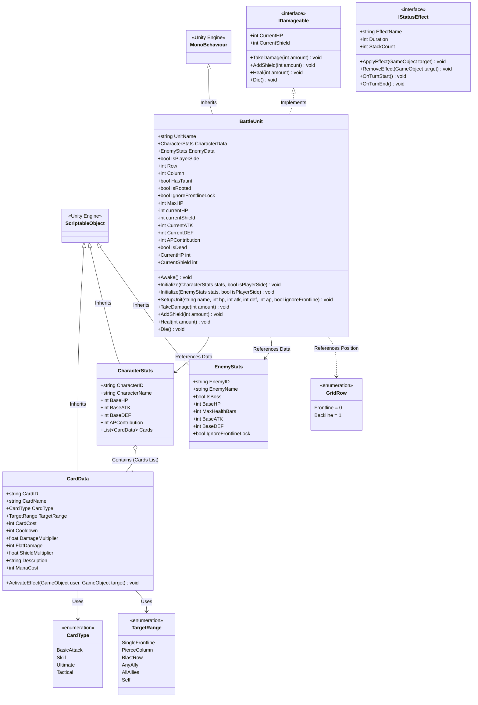

# TÀI LIỆU THIẾT KẾ KIẾN TRÚC DỮ LIỆU - US-005
## UML Class Diagram: Cụm Dữ Liệu Thẻ Bài (CardData) & Tướng (CharacterStats)

- **Mã User Story**: US-005
- **Tên User Story**: UML: Vẽ sơ đồ Class Diagram cho cụm dữ liệu Thẻ bài (CardData) và Tướng (CharacterStats).
- **Phân hệ**: Data Architecture / Core Combat
- **Độ ưu tiên**: CAO
- **Ước lượng (Hours)**: 4 giờ
- **Trạng thái**: HOÀN THÀNH

---

### 1. Giới thiệu & Mục tiêu
Tài liệu này đặc tả cấu trúc dữ liệu theo mô hình hướng đối tượng cho cụm Thẻ bài (`CardData`) và Tướng (`CharacterStats`) trong trò chơi chiến thuật thẻ bài **Antigravity**. Hệ thống được thiết kế theo kiến trúc **Data-Driven Architecture** sử dụng `ScriptableObject` của Unity, tách biệt hoàn toàn giữa dữ liệu tĩnh (Data Definitions) và trạng thái động trong trận đấu (`BattleUnit`).

---

### 2. Sơ đồ UML Class Diagram

> File StarUML Project: [Antigravity_StarUML_Project.mdj](file:///c:/Users/ADMIN/Downloads/game%20unity/Docs/UML/Antigravity_StarUML_Project.mdj)  
> Ảnh xuất chất lượng cao: [US-005_Class_Diagram.png](file:///c:/Users/ADMIN/Downloads/game%20unity/Docs/UML/US-005_Class_Diagram.png) | [Vector SVG](file:///c:/Users/ADMIN/Downloads/game%20unity/Docs/UML/US-005_Class_Diagram.svg)

#### Sơ đồ cấu trúc Mermaid:

---

### 3. Chi tiết các thành phần trong cụm dữ liệu

#### 3.1. Class `CardData` (Kế thừa `ScriptableObject`)
- **Vai trò**: Đại diện cho 1 thẻ bài kỹ năng trong game. Có thể là đòn đánh thường (`BasicAttack`), kỹ năng (`Skill`), chiêu cuối (`Ultimate`), hoặc thẻ chiến thuật bổ trợ (`Tactical`).
- **Thuộc tính chính**:
  - `CardID` (`string`): Định danh duy nhất của thẻ (ví dụ: `CARD_PALADIN_01`).
  - `CardName` (`string`): Tên hiển thị (ví dụ: *Sóng Xung Kích*, *Tường Ánh Sáng*).
  - `CardType` (`CardType`): Thể loại thẻ.
  - `TargetRange` (`TargetRange`): Tầm tác động (Đơn mục tiêu tiền tuyến, Xuyên thấu cột dọc, Nổ lan hàng ngang, v.v.).
  - `CardCost` / `ManaCost` (`int`): Năng lượng tiêu hao khi sử dụng trong lượt.
  - `Cooldown` (`int`): Số lượt hồi chiêu trước khi có thể tái kích hoạt.
  - `DamageMultiplier` (`float`): Hệ số sát thương tính theo tỉ lệ % ATK của nhân vật (mặc định 1.0f).
  - `FlatDamage` (`int`): Lượng sát thương cố định cộng thêm.
  - `ShieldMultiplier` (`float`): Hệ số tạo giáp ảo theo tỉ lệ % DEF của nhân vật.
  - `Description` (`string`): Mô tả kỹ năng cho người chơi theo dõi trên UI.
- **Phương thức**:
  - `ActivateEffect(GameObject user, GameObject target)`: Phương thức ảo (virtual) cho phép ghi đè để thực thi hiệu ứng đặc thù khi kích hoạt thẻ.

#### 3.2. Class `CharacterStats` (Kế thừa `ScriptableObject`)
- **Vai trò**: Cấu hình mẫu dữ liệu nền tảng cho từng Tướng (Hero/Champion). Dữ liệu này bất biến trong runtime và được dùng để khởi tạo `BattleUnit`.
- **Thuộc tính chính**:
  - `CharacterID` (`string`): Mã định danh tướng (ví dụ: `HERO_PALADIN`, `HERO_SNIPER`).
  - `CharacterName` (`string`): Tên hiển thị của tướng.
  - `BaseHP` (`int`): Máu cơ bản.
  - `BaseATK` (`int`): Sức tấn công cơ bản.
  - `BaseDEF` (`int`): Chỉ số phòng ngự cơ bản (dùng để giảm trừ sát thương).
  - `APContribution` (`int`): Điểm năng lượng đóng góp vào tổng `Total Turn Cost` của đội hình đầu lượt.
  - `Cards` (`List<CardData>`): Danh sách đúng 3 thẻ kỹ năng độc quyền của tướng:
    - Slot 0: Basic Attack (Đánh thường)
    - Slot 1: Skill (Kỹ năng đặc biệt)
    - Slot 2: Ultimate (Chiêu cuối)

#### 3.3. Class `EnemyStats` (Kế thừa `ScriptableObject`)
- **Vai trò**: Cấu hình chỉ số cho quái vật thường và Boss.
- **Thuộc tính chính**:
  - `EnemyID` (`string`), `EnemyName` (`string`), `IsBoss` (`bool`).
  - `BaseHP` (`int`), `MaxHealthBars` (`int` - Boss có thể có nhiều thanh máu), `BaseATK`, `BaseDEF`.
  - `IgnoreFrontlineLock` (`bool`): Cờ cho phép quái vật bỏ qua luật Khóa Tiền Tuyến (ví dụ Goblin đột kích).

#### 3.4. Class `BattleUnit` (Kế thừa `MonoBehaviour`, hiện thực `IDamageable`)
- **Vai trò**: Đại diện cho thực thể chiến đấu sống trên lưới 2x3 trong trận đấu.
- **Tương tác**:
  - Nạp dữ liệu từ `CharacterStats` (nếu là phe ta) hoặc `EnemyStats` (nếu là quái vật).
  - Quản lý trạng thái thực tế: `CurrentHP`, `CurrentShield`, vị trí tọa độ `(Row, Column)` trên lưới.
  - Hiện thực logic xử lý sát thương theo Damage Pipeline: Sát thương trừ vào `CurrentShield` trước, phần Overkill mới trừ vào `CurrentHP`.

---

### 4. Bảng liên kết dữ liệu mẫu

| Thuộc tính / Entity | Paladin (Ánh Sáng) | Sniper (Xạ Thủ) | Goblin Thường |
| :--- | :--- | :--- | :--- |
| **Class Loại** | `CharacterStats` | `CharacterStats` | `EnemyStats` |
| **Mã ID** | `HERO_PALADIN` | `HERO_SNIPER` | `ENEMY_GOBLIN_01` |
| **Máu cơ bản (BaseHP)** | 1800 | 950 | 450 |
| **Công cơ bản (BaseATK)** | 20 | 85 | 35 |
| **Thủ cơ bản (BaseDEF)** | 80 | 15 | 10 |
| **AP Đóng góp (APContribution)** | 5 | 1 | 0 |
| **Bộ thẻ bài (Cards)** | [Sóng Xung Kích, Tường Ánh Sáng, Tiên Phong Bất Tử] | [Mũi Tên Gió, Mũi Tên Chấn Động, Xuyên Tâm Tiễn] | Không có (Dùng Enemy AI Pattern) |
