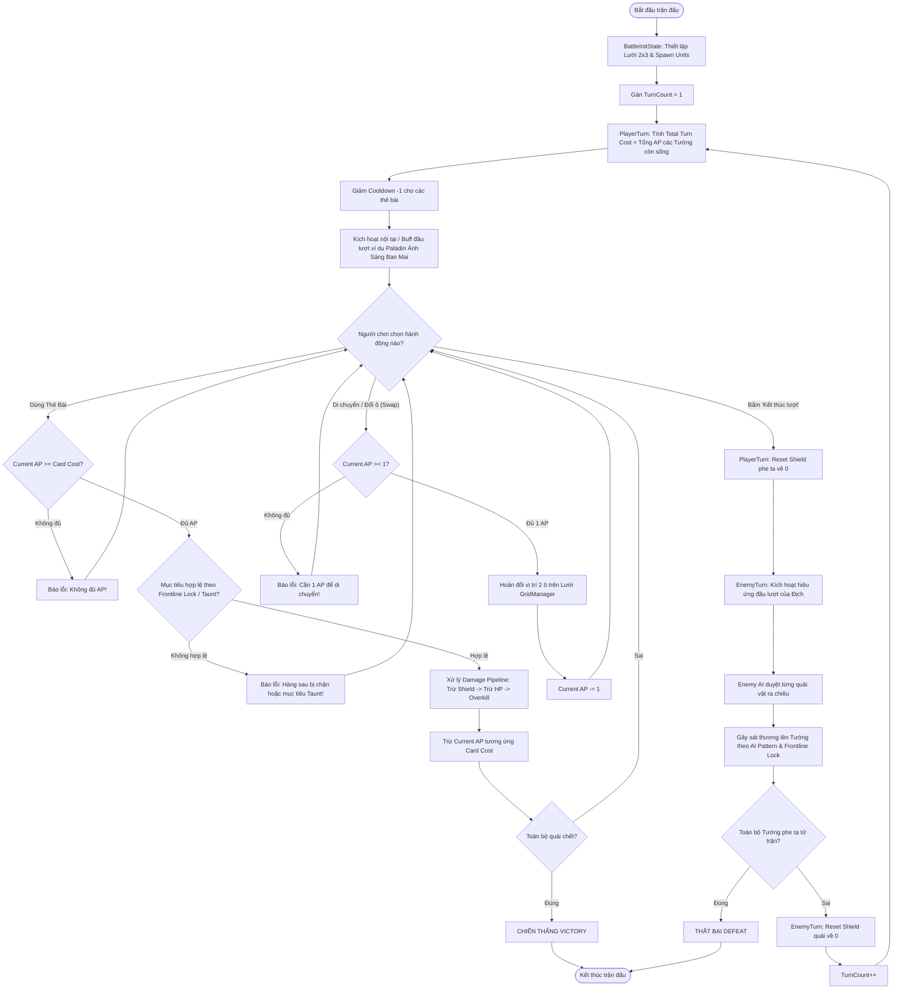

# TÀI LIỆU THIẾT KẾ VÒNG LẶP TRẬN ĐẤU - US-006
## UML State Machine & Hoạt Động Cho Vòng Lặp Trận Đấu (Turn Flow)

- **Mã User Story**: US-006
- **Tên User Story**: UML: Vẽ sơ đồ State Machine / Hoạt động cho Vòng lặp trận đấu (Turn Flow).
- **Phân hệ**: Combat System / Turn Management
- **Độ ưu tiên**: CAO
- **Ước lượng (Hours)**: 3 giờ
- **Trạng thái**: HOÀN THÀNH

---

### 1. Tổng quan & Thiết kế kiến trúc
Hệ thống vòng lặp trận đấu trong **Antigravity** được xây dựng dựa trên mẫu thiết kế **State Pattern** thông qua các thành phần:
- `TurnManager`: Lớp Context điều phối toàn bộ chu trình trận đấu.
- `ITurnState`: Interface định nghĩa các hàm trạng thái `EnterState()`, `UpdateState()`, `ExitState()`.
- Các trạng thái cụ thể:
  1. `BattleInitState`: Khởi tạo môi trường, thiết lập lưới 2x3, nạp đội hình tướng và quái vật.
  2. `PlayerTurnState`: Quản lý toàn bộ pha hành động của người chơi (hồi năng lượng, giảm cooldown, đánh bài, đổi ô chiến thuật Swap).
  3. `EnemyTurnState`: Quản lý lượt phản công tự động của kẻ địch (duyệt danh sách quái, chạy AI Pattern).
  4. `BattleEndState` (`VictoryState` / `DefeatState`): Kết thúc trận đấu và hiển thị kết quả.

---

### 2. Sơ đồ UML State Machine Diagram

> File StarUML Project: [Antigravity_StarUML_Project.mdj](file:///c:/Users/ADMIN/Downloads/game%20unity/Docs/UML/Antigravity_StarUML_Project.mdj)  
> Ảnh xuất chất lượng cao: [US-006_Turn_Flow_State_Machine.png](file:///c:/Users/ADMIN/Downloads/game%20unity/Docs/UML/US-006_Turn_Flow_State_Machine.png) | [Vector SVG](file:///c:/Users/ADMIN/Downloads/game%20unity/Docs/UML/US-006_Turn_Flow_State_Machine.svg)

#### Sơ đồ cấu trúc Mermaid:

```mermaid
stateDiagram-v2
    [*] --> BattleInitState : Bắt đầu trận đấu

    state BattleInitState {
        [*] --> SetupGrids : Khởi tạo lưới 2x3 (GridManager)
        SetupGrids --> SpawnUnits : Triển khai Tướng & Quái
        SpawnUnits --> CalculateInitialAP : Tính AP ban đầu từ Tướng
        CalculateInitialAP --> [*] : TurnCount = 1
    }

    BattleInitState --> PlayerTurnState : Hoàn tất nạp dữ liệu

    state PlayerTurnState {
        [*] --> Player_StartTurn : Vào lượt người chơi
        
        state Player_StartTurn {
            CalcTotalAP : Tính Total Turn Cost từ Tướng còn sống
            DecCooldown : Giảm Cooldown tất cả thẻ (-1)
            TriggerBuffs : Kích hoạt hiệu ứng đầu lượt (DoT, Shield)
            CalcTotalAP --> DecCooldown
            DecCooldown --> TriggerBuffs
        }

        Player_StartTurn --> Player_ActionPhase : Sẵn sàng hành động

        state Player_ActionPhase {
            WaitPlayerInput : Chờ lệnh người chơi
            
            WaitPlayerInput --> PlayCard : Kéo thả / Kích hoạt thẻ bài
            state PlayCard {
                CheckAP : Kiểm tra Current AP >= Card Cost
                CheckTarget : Kiểm tra mục tiêu (Frontline Lock & Range)
                ApplyCombat : Thi triển sát thương / tạo Shield
                DeductAP : Trừ Current AP theo Card Cost
                CheckAP --> CheckTarget : Đủ AP
                CheckTarget --> ApplyCombat : Mục tiêu hợp lệ
                ApplyCombat --> DeductAP
            }
            PlayCard --> WaitPlayerInput : Hoàn thành chiêu thức

            WaitPlayerInput --> MoveSwap : Lệnh Di chuyển / Đổi ô
            state MoveSwap {
                CheckSwapCost : Kiểm tra Current AP >= 1
                SwapGridPositions : Đổi chỗ 2 ô trên lưới
                DeductSwapAP : Trừ 1 AP
                CheckSwapCost --> SwapGridPositions : Đủ 1 AP
                SwapGridPositions --> DeductSwapAP
            }
            MoveSwap --> WaitPlayerInput : Cập nhật vị trí
        }

        Player_ActionPhase --> Player_EndTurn : Bấm nút Kết thúc lượt / Hết hành động

        state Player_EndTurn {
            ResetPlayerShield : Reset Giáp ảo (Shield) tạm thời về 0
            ClearTurnFlags : Xóa cờ trạng thái tạm thời
            ResetPlayerShield --> ClearTurnFlags
        }

        Player_EndTurn --> [*]
    }

    PlayerTurnState --> CheckVictoryFromPlayer : Kết thúc lượt chơi / Quái chết
    CheckVictoryFromPlayer --> VictoryState : Toàn bộ Quái vật tử trận
    CheckVictoryFromPlayer --> EnemyTurnState : Còn quái vật sống sót

    state EnemyTurnState {
        [*] --> Enemy_StartTurn : Vào lượt kẻ địch

        state Enemy_StartTurn {
            TriggerEnemyBuffs : Xử lý DoT / Buff đầu lượt quái
        }

        Enemy_StartTurn --> Enemy_AIPhase : Bắt đầu hành động AI

        state Enemy_AIPhase {
            ScanTargets : AI dò tìm mục tiêu (vd: %HP thấp nhất)
            ValidateAttack : Kiểm tra quy tắc Khóa Tiền Tuyến
            ExecuteEnemySkill : Gây sát thương lên Tướng phe ta
            ScanTargets --> ValidateAttack
            ValidateAttack --> ExecuteEnemySkill
        }

        Enemy_AIPhase --> Enemy_EndTurn : Tất cả quái hoàn tất lượt

        state Enemy_EndTurn {
            ResetEnemyShield : Reset Giáp ảo của quái về 0
            IncrementTurnCount : Tăng biến đếm lượt (TurnCount++)
            ResetEnemyShield --> IncrementTurnCount
        }

        Enemy_EndTurn --> [*]
    }

    EnemyTurnState --> CheckDefeatFromEnemy : Kết thúc lượt quái / Tướng chết
    CheckDefeatFromEnemy --> DefeatState : Toàn bộ Tướng phe ta tử trận
    CheckDefeatFromEnemy --> PlayerTurnState : Còn ít nhất 1 Tướng sống sót

    state VictoryState {
        [*] --> ShowVictoryScreen : Hiển thị bảng Thắng & Phần thưởng
    }

    state DefeatState {
        [*] --> ShowDefeatScreen : Hiển thị bảng Thất Bại & Thử lại
    }

    VictoryState --> [*] : Thoát về màn hình chọn ải
    DefeatState --> [*] : Rời trận đấu
```

---

### 3. Sơ đồ Hoạt động Chi tiết (Turn Loop Activity Diagram)

---

### 4. Bảng Đặc tả Chuyển dịch Trạng thái (State Transition Table)

| Trạng thái hiện tại | Sự kiện kích hoạt (Event / Trigger) | Điều kiện kiểm tra (Guard Condition) | Hành vi thực thi (Actions) | Trạng thái kế tiếp |
| :--- | :--- | :--- | :--- | :--- |
| **BattleInitState** | Nạp xong dữ liệu Grid và Unit | Dữ liệu khởi tạo hợp lệ | Gán `TurnCount = 1`, nạp giao diện chiến đấu | `PlayerTurnState` |
| **PlayerTurnState** | Bắt đầu lượt (`EnterState`) | Luôn luôn | Cộng dồn AP các tướng sống sót thành `TotalTurnCost`, giảm 1 lượt CD thẻ | Giữ nguyên trạng thái (chờ input) |
| **PlayerTurnState** | Người chơi đánh thẻ bài | `CurrentAP >= CardCost` và mục tiêu thỏa mãn `Frontline Lock` / `Taunt` | Kích hoạt hiệu ứng thẻ, trừ AP, áp dụng Damage Pipeline lên mục tiêu | Giữ nguyên trạng thái |
| **PlayerTurnState** | Người chơi hoán đổi ô (Swap) | `CurrentAP >= 1` và 2 ô thuộc phạm vi lưới 2x3 | Hoán đổi vị trí 2 nhân vật trên `GridManager`, trừ 1 AP | Giữ nguyên trạng thái |
| **PlayerTurnState** | Tất cả quái vật chết sau đòn đánh | `AllEnemiesDead == true` | Dừng nhận lệnh, mở màn hình tổng kết thắng | `VictoryState` |
| **PlayerTurnState** | Bấm nút "End Turn" | Người chơi xác nhận kết thúc | Reset toàn bộ `CurrentShield` phe ta về 0 | `EnemyTurnState` |
| **EnemyTurnState** | Bắt đầu lượt quái (`EnterState`) | Luôn luôn | Kích hoạt xử lý DoT / buff trạng thái của quái | Giữ nguyên trạng thái (chạy AI) |
| **EnemyTurnState** | Quái chạy AI Pattern | Quái còn sống | Tìm mục tiêu (%HP thấp nhất hoặc ngẫu nhiên tiền tuyến), tung chiêu | Giữ nguyên trạng thái |
| **EnemyTurnState** | Toàn bộ tướng phe ta chết | `AllPlayerUnitsDead == true` | Ngừng lượt đấu, mở màn hình thất bại | `DefeatState` |
| **EnemyTurnState** | Quái hoàn tất đòn đánh | Còn ít nhất 1 Tướng phe ta sống | Reset `CurrentShield` quái về 0, tăng `TurnCount++` | `PlayerTurnState` |
